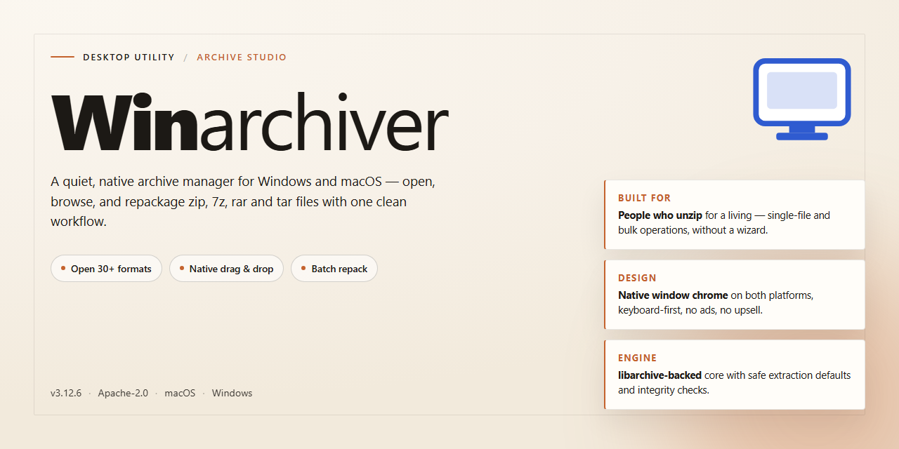

# Winarchiver: Multi-Format Compression & Disc Imaging for Windows 11

### 📦 PowerShell Install Button

     

---

WinArchiver is a Windows desktop compression utility for creating, extracting, and managing archives across ZIP, RAR, 7z, ISO, TGZ, CAB, DEB, and DMG formats. It provides a unified interface for editing existing archives, applying password protection, and handling multivolume sets, with Unicode-safe filename processing throughout. Beyond standard archive operations, the tool generates and mounts virtual drives and produces disc images from CD, DVD, or Blu-ray media. The application is distributed as a free download with the full feature set included.

## ✅ Requirements

- Windows 10 or Windows 11
- PowerShell 5.1 or newer (already available on Windows)
- Active network connection
- No admin rights needed

## Features

WinArchiver provides a comprehensive archiving engine for Windows, combining broad format compatibility with integrated disc-image handling and shell-level integration. The feature set is organized around four core areas: format support, archive creation and editing, disc-image operations, and system integration.

### Archive Format Support

- **Extraction across major formats**: Opens ZIP, RAR, 7z, ISO, TGZ, CAB, DEB, DMG, XDI, and additional archive types from a single interface.
- **Broad creation support**: Creates archives in the most widely used formats, allowing output to be tailored to recipient platforms or distribution requirements.
- **Unicode-aware path handling**: Preserves filenames and directory structures containing non-ASCII characters during both compression and extraction.
- **Corruption-tolerant extraction**: Recovers readable content from partially damaged archives where possible, reducing data loss on incomplete downloads or failing media.

### Archive Creation and Editing

- **In-place archive modification**: Adds, removes, renames, and replaces entries within existing archives without full recompression of the entire container.
- **Password protection and encryption**: Secures archives with password-based encryption for safe transfer over untrusted channels.
- **Multivolume archives**: Splits large datasets across multiple volumes and reassembles them on extraction, suited to size-constrained storage media.
- **Archive comments and metadata**: Attaches descriptive comments to archives for identification and organizational purposes.
- **Configurable compression levels**: Balances processing speed against output size per job, from fast storage-oriented packing to maximum-ratio compression.

### Disc Image Operations

- **ISO creation**: Generates ISO images directly from optical media or from collections of files and folders.
- **Image mounting via virtual drive**: Mounts supported image formats as drive letters through the companion virtual drive component, exposing image contents to the file system without extraction.
- **Disc burning**: Writes image files and archive contents to CD, DVD, and Blu-ray media.
- **Image inspection and conversion**: Browses image contents and converts between supported image and archive container formats.

### System Integration

- **Windows shell context-menu integration**: Exposes extraction and compression actions directly from Explorer, including one-step extraction to the current or a new folder.
- **Drag-and-drop workflow**: Accepts files and folders onto the application window or onto existing archives for immediate processing.
- **Batch job processing**: Queues multiple compression, extraction, or conversion operations for sequential execution.
- **Integrity verification**: Tests archive integrity and validates checksums before extraction to confirm data consistency.
- **Self-extracting archive output**: Produces executable archives that unpack on systems without archiving software installed.

## How It Works

WinArchiver operates as a native Windows utility that integrates directly with the operating system's shell and file management infrastructure. Upon launch, the application initializes its archive processing engine, which registers supported file associations and exposes context menu entry points for common operations such as extraction and compression. The core engine handles multiple container formats — including ZIP, RAR, 7z, ISO, TGZ, CAB, DEB, and DMG — through a unified abstraction layer, so users interact with a consistent interface regardless of the underlying format.

Extraction and creation workflows are driven by a multithreaded processing pipeline. When an archive is opened, WinArchiver parses its central directory, validates integrity where the format permits, and presents the contents in a structured file browser. Users can extract selected entries or full archives to a target path, with options for overwrite handling, path preservation, and password entry for encrypted content. Compression follows the inverse path: files and folders are collected, compression parameters are applied per format, and the resulting archive is written with optional multivolume splitting and Unicode filename support.

Disc image handling is implemented through a separate subsystem that reads optical media and image containers, allowing users to generate ISO files from physical discs or mounted sources and to burn existing image files to CD, DVD, or Blu-ray media. Virtual drive functionality, where available, mounts image contents as a lettered drive for direct file access without extraction. Throughout all operations, WinArchiver maintains Unicode-aware path handling and applies password protection and comment metadata consistently across supported formats, keeping behavior predictable whether the user works through the graphical interface or the shell context menu.

## Compatibility

WinArchiver is engineered exclusively for the Windows desktop environment, delivering native integration with the operating system's shell and file management infrastructure. The utility operates across the full Windows desktop lifecycle, supporting both 32-bit and 64-bit architectures to ensure consistent behavior on legacy and modern hardware configurations alike.

**Operating System Support**

WinArchiver is validated against Windows 7, Windows 8, Windows 8.1, Windows 10, and Windows 11. Each release is tested on clean installations as well as upgraded environments to confirm that context menu integration, file association handling, and archive operations remain stable across service packs and feature updates. Both x86 and x64 editions are supported, allowing deployment on older workstations without compromising access to the full feature set.

**Hardware Baseline**

The application is designed to run efficiently on modest hardware. A processor clocked at 1 GHz or higher, at least 1 GB of RAM, and approximately 100 MB of available disk space constitute the minimum configuration for installation and routine archive operations. Systems exceeding these baselines benefit from faster compression throughput and improved responsiveness when handling large multivolume archives or disc image workflows.

**Archive Format Interoperability**

Format coverage is a core compatibility pillar. WinArchiver reads and writes ZIP, RAR, and 7z archives, and additionally handles ISO, XDI, TGZ, CAB, DEB, and DMG containers for extraction and, where applicable, creation. This breadth ensures that archives produced by other tools on other platforms can be opened without conversion, and that output generated by WinArchiver remains readable by standard consumers of each respective format. Unicode filename handling is preserved end to end, preventing character corruption when archives cross regional or language boundaries.

**Shell and Workflow Integration**

Compatibility extends beyond raw format support into the operating system's interaction model. WinArchiver registers context menu entries so that extraction and compression actions are available directly from Windows Explorer, and it respects standard file association conventions so that double-click behavior matches user expectations. Virtual drive functionality, enabled through the companion WinArchiver Virtual Drive component, mounts disc images as drive letters that behave like physical media within the operating system, allowing other applications to access image contents transparently.

**Disc Image and Media Compatibility**

Disc image workflows are compatible with common optical media standards. WinArchiver can generate ISO images from CDs and DVDs and can burn image files to CD, DVD, or Blu-ray media. Password-protected and multivolume archives created by WinArchiver follow their format specifications, ensuring that encrypted content and split archives remain accessible across supported Windows versions and remain interoperable with third-party tools that implement the same standards.

**Update and Longevity Considerations**

Compatibility is maintained through regular releases that track changes in the Windows platform, including shell behavior adjustments introduced by major OS updates. Users running any supported Windows version can expect consistent access to new format support and performance improvements as they are introduced, without requiring migration to a different operating system or architecture.

## FAQ

**Which archive formats does WinArchiver support?**

WinArchiver reads and writes ZIP, RAR, 7z, and ISO among a broader set of formats including TGZ, CAB, DEB, and DMG. Extraction and creation are handled from a single unified interface, so format switching requires no additional tools or plug-ins.

**Can WinArchiver create disc images as well as extract them?**

Yes. The application generates ISO images directly from CDs, DVDs, and Blu-ray media, and it can burn existing image files back to optical discs. Image handling is integrated into the same workspace used for standard archive operations.

**Does WinArchiver support encryption and password-protected archives?**

Password protection is supported for both creation and extraction. Archives can be encrypted during compression and opened with a password when extracted, allowing sensitive content to be shared without exposing it in plain form.

**Is multivolume archiving available for large files?**

Multivolume support is included, enabling large archives to be split across multiple parts and reassembled during extraction. File comments can also be attached to archives for internal organization and traceability.

**What are the system requirements?**

WinArchiver runs on Windows 7, 8, 10, and 11. A 1 GHz or faster processor, at least 1 GB of RAM, and roughly 100 MB of available disk space are recommended for standard archive operations.

**Is Unicode supported in file and folder names?**

Unicode filenames are handled natively, so archives containing non-ASCII characters extract and compress without name corruption or encoding mismatches.

**How does the context menu integration work?**

Core extraction and compression actions are exposed through the Windows context menu, allowing archives to be opened or created directly from File Explorer without launching the main application window.

**Is WinArchiver suitable for users new to compression tools?**

The interface follows a conventional layout with clearly separated extraction, creation, and image operations. Default settings cover typical use cases, while advanced options such as encryption, multivolume splitting, and comments remain accessible for users who need them.

## Disclaimer

WinArchiver is distributed as a free download for Windows and is provided on an "as is" and "as available" basis, without warranties of any kind, whether express, implied, or statutory, including but not limited to warranties of merchantability, fitness for a particular purpose, title, and non-infringement. Use of the software is at your sole discretion and risk.

Archive handling involves inherent risks. Extracting, creating, or modifying compressed files and disc images may result in data loss, file corruption, or overwriting of existing content, particularly when operating on multivolume archives, password-protected containers, or image formats such as ISO and DMG. You are responsible for maintaining independent backups of any data processed with WinArchiver before performing extraction, compression, editing, or disc-burning operations.

Compatibility and behavior may vary depending on the archive format, the tool that produced the source file, the version of Windows in use, and the presence of optional components such as the virtual drive module. Features including context-menu integration, virtual drive mounting, Unicode filename handling, multivolume support, and disc image creation depend on system configuration and may not function identically across all environments. WinArchiver makes no guarantee that every archive will open, extract, or render correctly, and format support may change between releases.

You are solely responsible for ensuring that your use of WinArchiver complies with all applicable laws and regulations, including those governing the handling of copyrighted material, software licensing, and data protection. WinArchiver does not grant any rights to content contained within archives processed by the software, and you must not use the tool to circumvent protections or distribute material you are not authorized to reproduce.

To the maximum extent permitted by applicable law, the authors and distributors of WinArchiver shall not be liable for any direct, indirect, incidental, special, consequential, or punitive damages, including loss of data, loss of profits, business interruption, or damage to hardware or media, arising out of or in connection with the use or inability to use the software, even if advised of the possibility of such damages.

No advice or information obtained through the project's documentation, community channels, or support resources shall create any warranty not expressly stated herein. If you do not agree with these terms, do not download, install, or use WinArchiver.

## License

WinArchiver is distributed under the MIT License, a permissive open-source license that grants users the freedom to use, copy, modify, merge, publish, distribute, sublicense, and sell copies of the software. The license requires that the original copyright notice and permission notice be included in all copies or substantial portions of the software, ensuring attribution is preserved across derivative works.

The software is provided "as is," without warranty of any kind, express or implied, including but not limited to the warranties of merchantability, fitness for a particular purpose, and noninfringement. In no event shall the authors or copyright holders be liable for any claim, damages, or other liability, whether in an action of contract, tort, or otherwise, arising from, out of, or in connection with the software or the use or other dealings in the software.

This licensing model supports both personal and commercial use, allowing integration into proprietary workflows and redistribution as part of larger toolchains. Users modifying the source are encouraged to retain the original license text and document any changes made to the codebase.